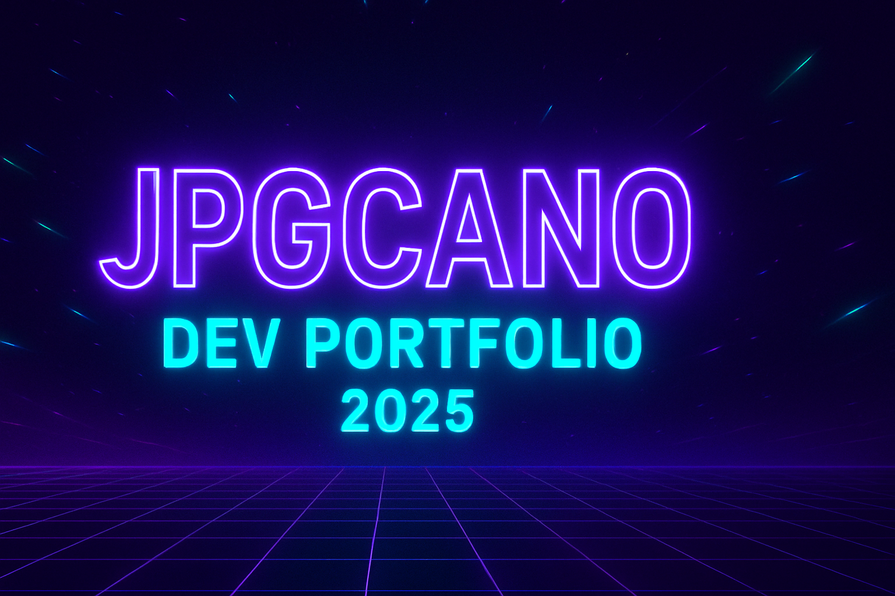

# Juan Pablo Cano Gallo  
**Desarrollador · Automatización con IA**

---

## Perfil  
Desarrollador enfocado en automatización de procesos con IA. Construyo aplicaciones, APIs y flujos que conectan sistemas y eliminan tareas manuales, con TypeScript, JavaScript, Python y n8n. Vengo del soporte técnico, donde aprendí a resolver problemas reales de usuarios antes de automatizarlos.

---

## Experiencia profesional  

**Contrato de capacitación — Riwi (Medellín)**  
*Septiembre 2025 – noviembre 2026*  
- Programa intensivo de desarrollo de software con Python, JavaScript, Angular, Next.js y Express  
- Automatización de procesos con IA, contenedores con Docker y servicios en Azure  

**Soporte en sitio — Service Request CFS (Medellín)**  
*Junio 2025 – actualidad*  
- Diagnóstico y resolución de fallas de hardware y software con atención presencial  
- Documentación de incidentes y soluciones en una base de conocimiento reutilizable  
- Reemplazo del software de seguridad en 4.500 equipos  
- Mantenimiento de 90 equipos en una semana  

**Administrador de soporte TI — Hospital San Juan de Dios (Sonsón)**  
*Junio 2023 – diciembre 2023*  
- Mantenimiento de computadores, impresoras y redes, y gestión del inventario de equipos  
- Soporte a los sistemas hospitalarios y al software clínico del personal  
- Migración de sistema operativo para cumplir las normativas de seguridad vigentes  
- Mapa de red y documentación de la infraestructura  
- Capacitación al personal en el uso de las herramientas tecnológicas  

**Practicante de desarrollo — Hospital Fundación San Vicente de Paúl (Medellín)**  
*Diciembre 2022 – junio 2023*  
- Automatización de procesos internos repetitivos con RPA (Rocketbot)  
- Desarrollo de soluciones en Python para el área de tecnología  
- Soporte tecnológico al personal durante la adopción de las automatizaciones  

---

## Formación académica  

**Ingeniería de Sistemas**  
Instituto Tecnológico Metropolitano (ITM), *julio 2025 – actualidad*

**Tecnólogo en Análisis y Desarrollo de Sistemas de Información**  
SENA, *agosto 2021 – diciembre 2023*

**Bachiller Académico**  
Institución Educativa San Lorenzo de Aburrá, *2013*

---

## Certificaciones  

- Azure Fundamentals — SENA, *2022*  
- Bootcamp: Ciberseguridad y nube de Azure — Intelligent Training, *2022*  
- Bootcamp: Administración y desarrollo SQL en Azure — Intelligent Training, *2022*  
- IA y Ciencia de Datos con Python — SENA y Everis, *2021*

---

## Habilidades técnicas

  
  
  
  
  
  
  
  
  
  
  
  
  
  
  
  

- **Lenguajes:** TypeScript, JavaScript (ES6+), Python, Java, SQL  
- **Automatización:** n8n, flujos con modelos de lenguaje, RPA con Rocketbot  
- **Web:** Astro, React, Next.js, Angular, Express, HTML5, CSS3, Tailwind CSS  
- **Datos:** PostgreSQL, Supabase, MySQL  
- **Infraestructura:** Docker, Azure, Git y GitHub, Linux  

---

## Habilidades personales  

- Pensamiento analítico  
- Resolución de problemas  
- Trabajo en equipo  
- Atención al detalle  
- Aprendizaje autodirigido  
- Orientación al logro

---

## Contacto  

[LinkedIn](https://www.linkedin.com/in/juancanogallo) • [Portafolio](https://portafolio.jpgcano.site) • jpgcano1@gmail.com  

## Autoría

© 2026 jpgcano · [github.com/jpgcano](https://github.com/jpgcano)

Publicado bajo licencia MIT. Ver [`LICENSE`](./LICENSE).
